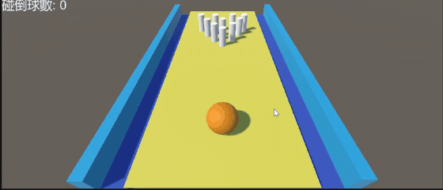

# 3D Bowling

用 **Unity(C#)** 製作的 3D 保齡球遊戲。提起球、環繞瞄準、蓄力後丟出，擊倒球道盡頭的 10 支球瓶；支援第二球補瓶與重新開局。

- **引擎：** Unity 2021.3(LTS)
- **語言：** C#
- **類型：** 3D 物理運動遊戲

## 遊戲玩法

1. 球道為淺黃色地板，兩側是深藍色溝槽與淺藍色牆，盡頭擺放 10 支白色球瓶，下方是一顆橘色大球。
2. 按住滑鼠左鍵把球提起，並拖曳滑鼠環繞球調整方向與俯仰角，滾輪拉近或拉遠。
3. 按住滑鼠右鍵蓄力，放開後球朝視線方向往前丟出。
4. 球滾進溝槽後會沿著邊滾動、不會彈回球道(洗溝)；球與球瓶、球瓶與球瓶之間都會互相碰撞。
5. 畫面左上角即時顯示被撞倒的球瓶數，10 支全倒時顯示 **Strike!**
6. 按 **右方向鍵** 丟第二球：球回到起點，只清除已經倒下的球瓶，留下的球瓶繼續擊打。
7. 按 **左方向鍵** 開始新的一局：球與所有球瓶回到原位，分數與訊息清空。

## 操作方式

| 操作 | 功能 |
|---|---|
| 按住左鍵拖曳 | 提起球、繞球旋轉視角並調整俯仰角 |
| 滑鼠滾輪 | 拉近 / 拉遠攝影機 |
| 按住右鍵 → 放開 | 蓄力 → 丟球 |
| `→` 右方向鍵 | 第二球：球歸位、清除已倒球瓶 |
| `←` 左方向鍵 | 新的一局：球與全部球瓶歸位、分數歸零 |

## 功能特色

- **物理碰撞**：球與球瓶皆使用 Rigidbody，碰撞、倒瓶、滾動都由物理引擎計算，每次擊球的結果都不同。
- **倒瓶判定**：球瓶被碰撞且相對速度大於門檻時標記為倒下，每支球瓶只計算一次，避免重複計分。
- **兩段式重設**：第二球只隱藏已倒下的球瓶(`SetActive(false)`)；整局重設則把每支球瓶的位置、角度、速度還原到初始狀態。
- **防止出界**：球道外圍設置隱形牆，球飛出場地或掉出球道時自動回到起點。
- **環繞攝影機與蓄力**：攝影機跟隨球移動並可環繞，蓄力大小與按住時間成正比，以衝力模式丟出。

## 程式說明

| 檔案 | 說明 |
|---|---|
| [`cylinder.cs`](cylinder.cs) | 球瓶。`Start` 記錄初始位置與角度；`OnCollisionEnter` 判定倒瓶並更新「碰倒球數」，達 10 支顯示 Strike!；右方向鍵 `HalfResetGame` 隱藏已倒球瓶，左方向鍵 `ResetGame` 還原位置、角度與速度並清空訊息。 |
| [`PlayerController.cs`](PlayerController.cs) | 保齡球。方向鍵施力微調，按左右方向鍵或掉出球道(y < -1)時回到起點並歸零速度。 |
| [`CameraController.cs`](CameraController.cs) | 環繞攝影機與蓄力丟球。左鍵拖曳時提起球並計算新視角，右鍵按住累積力道，放開時沿攝影機水平視線對球 `AddForce`。 |
| [`invicibleWall.cs`](invicibleWall.cs) | 隱形牆。以 Trigger 偵測球(Tag `Player`)，碰到時把球放回 (0, 0.5, 0) 並停止滾動。 |

## 在 Unity 中使用

1. 以 Unity 2021.3 建立 3D 專案，將所有 `.cs` 檔放入 `Assets/Scripts/`。
2. 建立球道、溝槽與兩側牆面；建立 10 個圓柱體作為球瓶(Tag 設為 `cylinder`，加上 Rigidbody 與 `cylinder`)，並指定分數與訊息的 UI Text。
3. 建立保齡球(Tag 設為 `Player`，加上 Rigidbody 與 `PlayerController`)。
4. 在球道外圍放置 Trigger Collider 並掛上 `invicibleWall`；在 Main Camera 掛上 `CameraController`，將球拖入 `player` 欄位。
